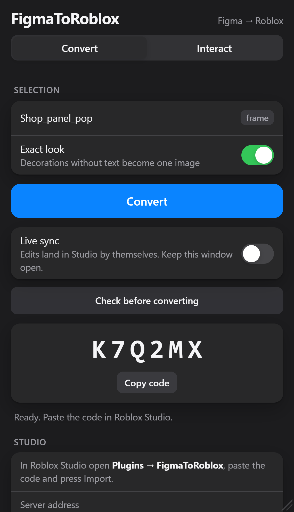
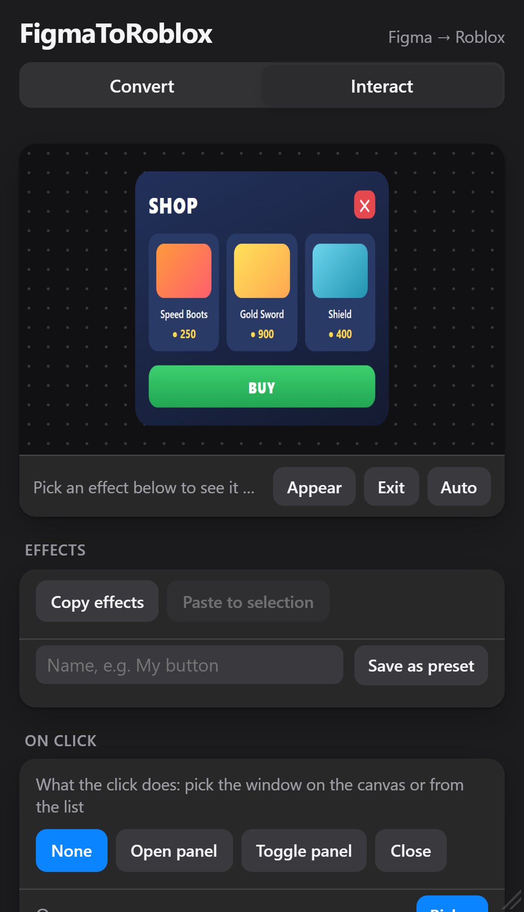
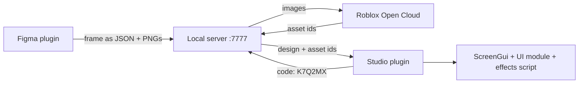

# FigmaToRoblox

Design a screen in Figma, copy a six-letter code, paste it in Roblox Studio. FigmaToRoblox rebuilds the frame as native Roblox UI (Frames, TextLabels, ImageLabels, UICorner, UIStroke, UIGradient, layouts) and wires up the interactions you tag in Figma: buttons, panels that open and close, tabs, hover effects and entrance animations.

<p align="center">
  <picture>
    <source media="(prefers-color-scheme: light)" srcset="docs/plugin-convert-light.png">
    
  </picture>
  <picture>
    <source media="(prefers-color-scheme: light)" srcset="docs/plugin-interact-light.png">
    
  </picture>
</p>

## How it works



1. The Figma plugin walks the selected frame and turns every layer into a node with its position, size, fills, strokes, corners, text and tags. What Roblox can't draw natively (vector shapes, blend modes, and decorations when *Exact look* is on) goes out as PNG.
2. A small Node server on your machine keeps the design under a random six-letter code for six hours and uploads the images to Roblox through Open Cloud. Uploads are cached by image hash, so converting the same frame again doesn't upload anything twice.
3. In Studio, the FigmaToRoblox plugin downloads the design with that code and builds a ScreenGui in StarterGui. It adds a LocalScript that runs the tagged effects and a `UI` ModuleScript with a typed reference to every layer, for your own scripts.

The server has no dependencies: it's Node's `http` module and `fetch`.

## Requirements

- Figma desktop app. Development plugins can't be imported in the browser version.
- Roblox Studio.
- Node.js 18 or newer.
- Windows for the guided setup. On macOS or Linux, use the manual setup.

## Install

### Windows, guided

Download `FigmaToRoblox.zip` from the [latest release](https://github.com/UiUyHerrera/FigmaToRoblox/releases/latest), extract it to a normal folder (not inside the zip preview) and double-click `Setup.bat`. The wizard:

- installs Node.js with winget if it's missing (it asks first),
- looks up your Roblox User ID from your username,
- opens the Creator Dashboard page where you create the API key and tells you what to tick,
- saves the key in `server/config.json`,
- installs the Studio plugin and puts a FigmaToRoblox shortcut on your desktop.

Then restart Roblox Studio and import the Figma plugin: Figma desktop → Plugins → Development → Import plugin from manifest → `figma-plugin/manifest.json`.

### Manual

```bash
git clone https://github.com/UiUyHerrera/FigmaToRoblox.git
cd FigmaToRoblox
npm run install-plugin   # builds the Studio plugin and copies it to Studio's Plugins folder
npm start                # starts the server on http://localhost:7777
```

1. Restart Roblox Studio. When the plugin asks, allow HTTP requests to `localhost` and script injection.
2. Import the Figma plugin from `figma-plugin/manifest.json`, as above.
3. Set up image upload (next section) if your designs have images.

### Image upload

Roblox only shows uploaded assets in a running game. Without an Open Cloud key, images appear in Studio while you edit but disappear when you press Play.

1. Go to the [Creator Dashboard credentials page](https://create.roblox.com/dashboard/credentials) and create an API key named `FigmaToRoblox`.
2. Under Access Permissions, add **Assets** with **Read** and **Write**.
3. Under Accepted IP Addresses, add your IP (or `0.0.0.0/0`).
4. Copy `server/config.example.json` to `server/config.json` and fill in `apiKey` and `userId` (the number in your Roblox profile URL). To upload to a group, use `groupId` instead of `userId`.
5. Restart the server. It should print `Open Cloud upload: enabled`.

`server/config.json` is ignored by git. Don't share it: anyone with that key can upload assets to your account.

## Using it

1. Start the server (desktop shortcut, `FigmaToRoblox.bat` or `npm start`) and leave the window open.
2. In Figma, select one frame and run FigmaToRoblox. **Check before converting** lists what will be skipped or turned into an image. Then click **Convert** and copy the code.
3. In Studio: Plugins → FigmaToRoblox → paste the code → **Import**. The UI lands in StarterGui.
4. Press Play to try the effects.

**Live sync**: turn it on in the Convert tab and every edit you make in Figma shows up in Studio on its own, under the same code, as long as both are open.

**Re-importing** the same frame updates the ScreenGui in place and keeps your scripts. Only the `UI` module is regenerated, so don't edit that one.

**Exact look** (on by default) turns decorations without text into a single image, so they look identical to Figma. Turn it off to keep everything as editable Roblox instances.

## Tags

Tags go at the end of a layer name, separated by underscores: `Buy_button_smooth`, `Shop_panel`, `Play_open:Shop`. You can also add them from the plugin's Interact tab, which explains each one. Their settings show up as attributes in Studio (`pop_Time`, `smooth_HoverScale`…), so you can tweak timings without importing again.

The ones you'll use the most:

| Tag | What it does |
|---|---|
| `_button` | Clickable button with hover and press feedback. Put it on the whole button frame. |
| `_smooth` | Button that grows on hover and shrinks on press. |
| `_panel` | Something buttons can open and close. Hide it in Figma to start closed. |
| `_open:Shop`, `_close`, `_toggle:Shop` | Buttons that open, close or toggle a panel. |
| `_tab:Weapons` | Shows its panel and hides the other tab panels in the group. |
| `_scroll` | Scrolling window. Use it on a frame with Clip content. |
| `_list`, `_grid` | Arrange the children with a UIListLayout or UIGridLayout. |
| `_textbox` | Player text input. The drawn text becomes the placeholder. |
| `_pop`, `_fadein`, `_cascade` | Entrance animations when the layer is shown. |
| `_popout`, `_fadeout` | Exit animations when it closes. |
| `_bind:leaderstats.Gems` | Text that shows a live value from the player. |
| `_bar:leaderstats.XP` | Fill bar that grows with a value. Set Max in its settings. |
| `_buy:12345` | Opens the purchase prompt for a product or game pass. |

All 81 tags are in [docs/TAGS.md](docs/TAGS.md). Inside any text, `{Coins}` also binds to a value, and numbers roll up to the new one when it changes.

## Scripting

Every import creates a `UI` ModuleScript inside the ScreenGui. Require it from your own LocalScript in the same ScreenGui:

```lua
local UI = require(script.Parent:WaitForChild("UI"))

UI.Comprar.Activated:Connect(function()
	UI.Open("Shop") -- plays the panel's entrance animation
end)

UI.Close("Shop")
UI.Toggle("Shop")
UI.All("Item")                    -- every layer with that name
UI.Toast("+100 coins")            -- notification at the top of the screen
UI.OnOpen("Shop", function() end) -- also UI.OnClose
UI.Fill("ItemCard", items, function(card, item)
	card.Title.Text = item.Name   -- clones keep their effects
end)
```

Layer names become identifiers: `Item 1` turns into `UI.Item1`, and repeated names get a suffix (`UI.Item1_2`).

## Limitations

- Inner shadows, layer and background blur, and text shadows are skipped. The plugin warns about each one.
- Layers with a blend mode other than Normal are exported as images.
- When the corners of a layer have different radii, Roblox gets the largest one.
- Codes live in the server's memory for six hours. Restarting the server forgets them; just convert again.

## Troubleshooting

| Message | Fix |
|---|---|
| Cannot reach the FigmaToRoblox server | The server window is closed. Open the shortcut or run `npm start`. |
| Code not found or expired | Codes last six hours and don't survive a server restart. Convert again. |
| Images don't show when playing | The server must say `Open Cloud upload: enabled`. Check `server/config.json`, or delete it and run `Setup.bat` again. |
| Studio still shows the old plugin | Close Studio completely and open it again. |

## Project layout

```
figma-plugin/     manifest, plugin logic (code.js) and its interface (ui.html)
roblox-plugin/
  src/            plugin.lua (Studio panel and importer), runtime.lua (effects), defaults.lua
  build.js        bundles src/ into dist/FigmaToRoblox.lua
  dist/           the single-file Studio plugin
server/           local server: codes, image upload and the asset cache
tools/            docs generator
Setup.ps1         Windows setup wizard (Setup.bat runs it)
FigmaToRoblox.bat installs the plugin and starts the server
```

`defaults.lua` is the single source of truth for effect timings and colors. `build.js` embeds it in the Studio plugin and mirrors it as JSON into `figma-plugin/code.js`, so both sides always agree. The Studio plugin ships as a single `.lua` file, so installing it is just copying that file into Studio's Plugins folder.

The project used to be called FigBridge. A few internal names keep the old one (the `FigBridgeRuntime` script, the `FB_` attributes and the Studio panel id) so designs imported with earlier versions still update in place, and installing over an old version removes `FigBridge.lua` from the Plugins folder.

## Development

```bash
npm run check   # syntax check of the JavaScript files
npm run build   # rebuilds dist/FigmaToRoblox.lua and syncs the defaults
npm run docs    # regenerates docs/TAGS.md
```

GitHub Actions runs the three on every push and fails if `dist/`, `code.js` or the tags doc don't match their sources.
